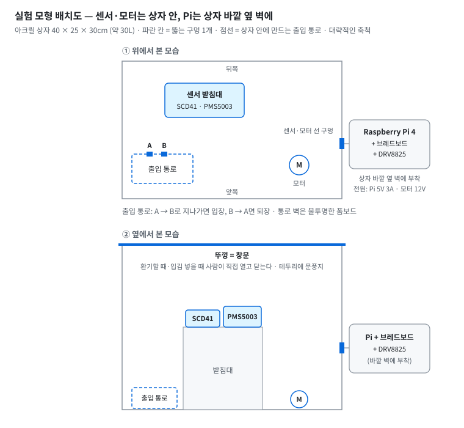

# 실험 모형 하드웨어 설계

SAD v0.6 7.2절(실험 모형)을 실제 조립에 맞게 단순화한 최종 설계다. 센서와 모터는 아크릴 상자 안에 넣고, Raspberry Pi는 브레드보드·모터 드라이버와 함께 상자 바깥 옆 벽에 붙인다. 상자에는 센서·모터 선이 지나갈 구멍 1개만 뚫는다. 환기는 사람이 뚜껑을 직접 열어서 하고, CO₂는 입김을 불어넣어 올린다.



## 1. 구성

| 구분 | 구성 | 비고 |
| --- | --- | --- |
| 상자 | 투명 아크릴 상자 40 × 25 × 30cm (약 30L) | 위 뚜껑이 열리는 구조, 테두리에 문풍지 |
| 창문 | 뚜껑 | 환기 신호가 나오면 사람이 직접 열고 닫는다 |
| 구멍 | 1개, Pi를 붙인 오른쪽 벽 (지름 약 2cm) | 센서 선과 모터 선이 통과, 선을 넣은 뒤 틈은 핫글루로 막는다 |
| 제어 | Raspberry Pi 4 (4GB) + GPIO 확장보드(T자) + 브레드보드 | 상자 바깥 오른쪽 벽에 부착 |
| CO₂·온습도 | SCD41 | 받침대 위, 가운데 뒤쪽 |
| 미세먼지 | PMS5003 + G7→G5 어댑터 | SCD41 옆 |
| 재실 인원 | VL53L0X × 2 (A, B) | 상자 안 앞쪽 왼쪽 바닥의 출입 통로 |
| 모터 | NEMA17 스테핑 모터 + DRV8825 드라이버 | 모터는 상자 안, 드라이버는 바깥 브레드보드. 환기 신호가 나오면 도는 표시 역할 |
| CO₂ 발생 | 입김 | 뚜껑을 살짝 열고 불어넣은 뒤 닫는다 |

### 출입 통로

- 폼보드로 폭 8~10cm의 통로를 만들고, 한쪽 벽에 VL53L0X 2개를 2~3cm 간격으로 붙인다.
- 통로 벽은 불투명해야 한다. 투명 아크릴 너머로는 거리를 제대로 재지 못한다.
- A → B 순서로 가려지면 입장(+1), B → A 순서면 퇴장(−1)으로 센다.
- 통과 물체는 폭 4cm 정도의 불투명한 막대를 쓴다.

## 2. 브레드보드 배치

센서와 모터 선은 구멍을 지나 바깥 브레드보드까지 와야 하므로 20~30cm 점퍼선을 쓴다. T자 확장보드는 브레드보드 1~20번 줄에 가운데 홈을 가로질러(d열·h열) 꽂는다. 3V3·5V0이 1번 줄에 온다. 센서 선은 확장보드 핀과 같은 가로줄의 빈 구멍에 꽂는다.

| 줄 | 왼쪽 (a~c열) | 오른쪽 (i~j열) |
| --- | --- | --- |
| 1 | 3V3 | 5V0 |
| 2 | SDA1 (GPIO2) | 5V0 |
| 3 | SCL1 (GPIO3) | GND |
| 4 | GPIO4 | TXD0 (GPIO14) |
| 5 | GND | RXD0 (GPIO15) |
| 6 | GPIO17 | GPIO18 |
| 7 | GPIO27 | GND |
| 8 | GPIO22 | GPIO23 |
| 9 | 3V3 | GPIO24 |
| 10 | SPI MOSI | GND |

- Pi와 확장보드를 잇는 리본 케이블은 확장보드 1번 줄(3V3·5V0)로 가는 선(갈색)이 **Pi의 1번 핀**(USB 포트에서 먼 쪽 끝)에 오게 꽂는다. Pi 쪽 커넥터는 거꾸로도 꽂히므로 주의한다.
- 5V0 줄에 꽂을 자리가 부족하면 1번 줄 j에서 오른쪽 + 레일로 점퍼선을 이어 **오른쪽 + 레일을 5V 전용**으로 쓴다. 3.3V 센서는 이 레일에 연결하지 않는다.

## 3. 배선

### SCD41 (I²C, 주소 0x62)

| SCD41 | 연결 |
| --- | --- |
| VCC | 3V3 (1번 줄 왼쪽) |
| GND | GND (5번 줄 왼쪽) |
| SDA | SDA1 (2번 줄 왼쪽) |
| SCL | SCL1 (3번 줄 왼쪽) |

### VL53L0X × 2 (I²C, 주소 0x29 → B를 0x30으로 변경)

| VL53L0X | A (바깥쪽) | B (안쪽) |
| --- | --- | --- |
| VIN | 3V3 | 3V3 |
| GND | GND | GND |
| SDA | SDA1 (SCD41과 공유) | SDA1 (공유) |
| SCL | SCL1 (공유) | SCL1 (공유) |
| XSHUT | GPIO17 (6번 줄 왼쪽) | 연결 안 함 |

두 센서의 기본 주소가 0x29로 같다. 부팅 시 GPIO17을 LOW로 두어 A를 끈 상태에서 B의 주소를 0x30으로 바꾸고, 그다음 A를 켠다.

### PMS5003 (UART, 9600bps)

PMS5003 케이블을 어댑터의 흰색 8핀 커넥터(P2)에 꽂고, 4핀 헤더(P3)를 연결한다.

| 어댑터 P3 | 연결 |
| --- | --- |
| VCC | 5V0 (내장 팬이 5V 필요) |
| GND | GND |
| TX | RXD0 (5번 줄 오른쪽) — 센서 TX → Pi RX로 교차 |
| RX | 연결 안 함 |

### 스테핑 모터 (DRV8825)

| DRV8825 | 연결 |
| --- | --- |
| VMOT / GND (VMOT 옆) | 12V 전원 + / − (두 핀 사이에 100µF 25V 이상 전해 커패시터) |
| GND (FLT 옆) | Pi GND |
| STP | GPIO18 (6번 줄 오른쪽) |
| DIR | GPIO23 (8번 줄 오른쪽) |
| EN | GPIO24 (9번 줄 오른쪽) — LOW = 동작, HIGH = 꺼짐 |
| RST, SLP | 두 핀을 서로 잇고 3V3에 연결 |
| A1, A2 / B1, B2 | 모터 코일 A / 코일 B |
| M0, M1, M2, FLT | 연결 안 함 (풀 스텝) |

- 모터 선 4개는 두 선을 맞대고 축을 돌렸을 때 뻑뻑해지는 쌍이 한 코일이다.
- 전류 제한은 드라이버의 가변저항으로 맞춘다. 이 보드(R100)는 **전류 제한 = Vref × 2**다. 표시용이므로 낮게 설정한다.
- 돌지 않을 때는 EN을 HIGH로 두어 모터 발열을 줄인다.
- DRV8825는 모터 전원이 8.2V 이상이어야 동작하므로 Pi의 5V로는 돌릴 수 없다.

## 4. Pi 설정과 동작 확인

1. `sudo raspi-config` → Interface Options에서 **I2C 켜기**, **Serial Port**는 로그인 셸 No · 하드웨어 Yes로 설정하고 재부팅한다.
2. `sudo apt install -y i2c-tools python3-serial`
3. `i2cdetect -y 1` → 주소 변경 후 **29, 30, 62**가 보이면 정상이다.
4. PMS5003 확인:
   ```
   python3 -c "import serial;s=serial.Serial('/dev/serial0',9600,timeout=3);print(s.read(32).hex())"
   ```
   출력에 `424d`로 시작하는 부분이 있으면 정상이다.
5. `vcgencmd get_throttled` → `throttled=0x0`이면 전원이 안정적이다. 0이 아니면 5V 배선 합선이나 전원 부족을 의심한다.

## 5. 주의 사항

- 배선은 Pi 전원과 12V 전원을 모두 끈 상태에서 한다. 전원이 켜진 채 모터 선을 뽑거나 꽂으면 드라이버가 망가진다.
- 전원은 Pi를 먼저 켜고 그다음 12V를 켠다.
- 3.3V 센서(SCD41, VL53L0X)의 VCC를 5V에 연결하지 않는다. SCD41 모듈의 풀업 저항 때문에 SDA·SCL에 5V가 걸려 Pi GPIO가 손상될 수 있다.
- 모터 전원은 Pi의 5V 핀에서 끌어오지 않는다. 전압이 떨어져 Pi가 재부팅되거나 와이파이가 끊길 수 있다.
- 모터는 상자 안에 있어 전류가 흐르는 동안 열이 난다. 돌지 않을 때는 EN을 HIGH로 꺼 둔다.

## 6. SAD 7.2 대비 변경 사항

| 항목 | SAD v0.6 | 이 설계 |
| --- | --- | --- |
| 창문 | 모터로 여닫는 플랩 + 배기 팬 | 뚜껑을 사람이 직접 연다. 모터는 환기 신호 표시 |
| 팬 | 순환 팬, 배기 팬 | 없음 |
| 흡기 구멍 | 역류 방지판이 달린 흡기 구멍 | 없음 |
| CO₂ 발생원 | 이스트 발효병 | 입김 |
| 상자 구멍 | 배기·흡기·센서 선 | 센서·모터 선 구멍 1개 |
